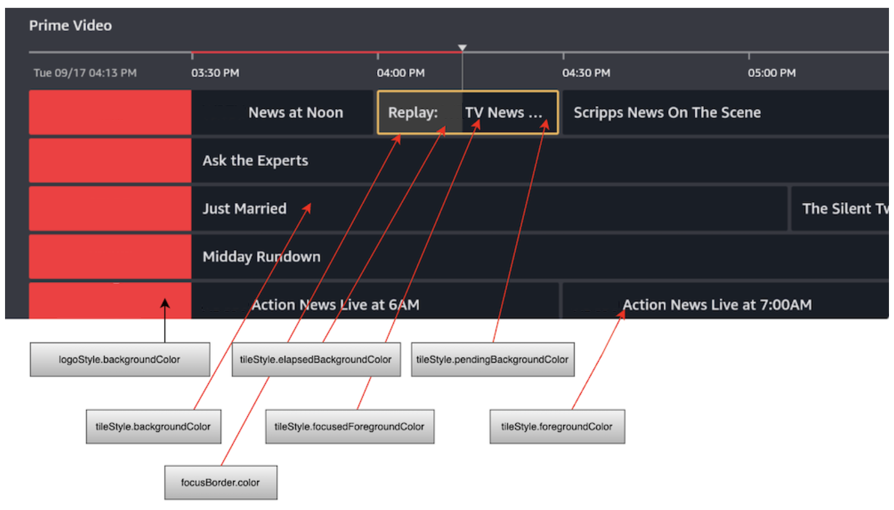
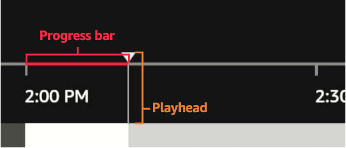
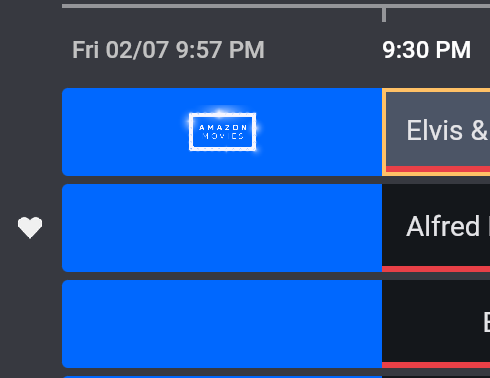

Vega EPG Sample App
=========================

Introduction
------------

The EPG (Electronic Program Guide) Sample App demonstrates how to use EPG components to build a TV Guide experience.


Build and run the app
--------------------

### Prerequisites

Before you launch the sample app, make sure that you have [installed the Vega SDK](https://developer.amazon.com/docs/vega/latest/install-vega-sdk.html).

Building this app requires Vega SDK 2.0 or later. The app targets Vega OS 2.0 (`min` and `target` in the `[os.version]` section of `manifest.toml`). To support OS 1.2 devices, you can set `min = "1.2"`, but then guard any API added after OS 1.2. See [Target OS versions](https://developer.amazon.com/docs/vega/latest/target-os-version.html).


### Step 1: Build the app

After you download the source code from GitHub, build the EPG Sample App from the command line to generate VPKG files. The VPKG files run on the Vega Virtual Device and Vega Fire TV Stick.

To build the app with [Vega Studio](https://developer.amazon.com/docs/vega/latest/setup-extension.html), use Visual Studio Code.

1. At the command prompt, navigate to the EPG Sample App source code directory.

2. To install the app dependencies, run the following command. The installation can take several minutes to complete.

   ```
   npm install
   ```

3. To build the app and generate .vpkg files, run the following command.

   ```
   npm run build:app
   ```

4. At the command prompt, in the **build** folder, verify that the build generated the VPKG files for your device architecture.

   * **armv7-release/epgsampleapp_armv7.vpkg**&mdash;Generated on x86_64 and Mac M-series devices to run on the Vega Fire TV Stick.
   * **x86_64-release/epgsampleapp_x86_64.vpkg**&mdash;Generated on x86_64 devices to run on the KVD.
   * **aarch64-release/epgsampleapp_aarch64.vpkg**&mdash;Generated on Mac M-series devices to run on the KVD.

### Step 2: Run the app

#### Vega Virtual Device

1. To start the Vega Virtual Device, run the following command at the command prompt.

   ```
   vega virtual-device start
   ```

2. To install and launch the app on the Vega Virtual Device, run the following command for your device architecture.

   - On Mac M-series based devices:

      ```
      vega run-app build/aarch64-release/epgsampleapp_aarch64.vpkg
      ```

   - On x86_64 based devices:

     ```
     vega run-app build/x86_64-release/epgsampleapp_x86_64.vpkg
     ```

#### Fire TV Stick

1. Turn on your Fire TV Stick.

2. To install and launch the app on your Fire TV Stick, run the following command.

   ```
   vega run-app build/armv7-release/epgsampleapp_armv7.vpkg
   ```


Update your package.json file
-----------------------------

The EPG component is `KeplerEPG` from the `@amazon-devices/keplerscript-epg` package. Make sure your **package.json** lists that package in its **dependencies** section as the following example shows.

```json
"dependencies": {
    // ...
    "@amazon-devices/keplerscript-epg": "^2.0.0",
}
```

EPG component usage and props
-----------------------------

The following code example shows the usage of the EPG component. You must also provide channel and program data through the [`updateData`](#updatedata-method) method.

```ts
<KeplerEPG
    ref={epg}
    onScroll={({ row, timeMs }: EPGScrollEvent) => {
        // handler code here
    }}
    onTileFocus={({ payload, title }: EPGTileFocusEvent) => {
        // handler code here
    }}
    onTilePress={({ payload, title }: EPGTilePressEvent) => {
        // handler code here
    }}
    onMenu={({ payload, title }: EPGMenuEvent) => {
        // handler code here
    }}
    focusBorder={{
        enabled: true,
        color: '#E4E4E7',
    }}
    tileStyle={{
        backgroundColor: '#191E25',
        foregroundColor: '#E4E4E7',
        focusedForegroundColor: '#E4E4E7',
        elapsedBackgroundColor: '#3D3D3D',
        pendingBackgroundColor: '#191E25',
    }}
    logoStyle={{
        backgroundColor: '#FF0E25',
        width: 340,
    }}
/>
```


| Prop | Description | Type | Optional | Default |
| --- | --- | --- | --- | --- |
| `onScroll` | Callback when the user moves to a different cell, after the animation completes. | `(event: EPGScrollEvent) => void` | Yes | |
| `onTileFocus` | Callback when the user focuses on a cell (lands on it for 250 ms or longer). | `(event: EPGTileFocusEvent) => void` | No | |
| `onTilePress` | Callback when the user selects a cell. | `(event: EPGTilePressEvent) => void` | No | |
| `onMenu` | Callback when the user presses the menu (three-line) button. | `(event: EPGMenuEvent) => void` | Yes | |
| `onMetricEmit` | Callback when the component emits performance-related metrics. | `(event: EPGMetricsEmitEvent) => void` | Yes | |
| `favoriteStyle` | Container for favorite-related props. | | Yes | |
| `favoriteStyle.imageOn` | Image in **assets/image** to display for a favorite channel. | `string` | No (if favoriteStyle is specified) | Without `favoriteStyle`, the favorite functionality is off, with no visual indicator of the favorite status. |
| `favoriteStyle.imageOff` | Image in **assets/image** to display for a non-favorite channel. | `string` | Yes | Blank image |
| `focusBorder` | Container for focus border props. | | Yes | |
| `focusBorder.enabled` | Displays a border around the focused cell. | `boolean` | No (if focusBorder is specified) | `FALSE` |
| `focusBorder.color` | Hex color value for the focused cell border. | `ColorValue` | Yes | #FFC166 |
| `localizedStrings` | Specifies the text that appears in the EPG component. Use `localizedStrings` to modify text that the data does not determine. | | Yes | |
| `localizedStrings.loadingText` | Text that appears on program tiles before data loads. | string | Yes | "Loading schedule..." |
| `localizedStrings.unavailableText` | Text that appears on program tiles when loaded data is invalid. | string | Yes | "Programming information unavailable." |
| `localizedStrings.favoriteAccessibilityLabel` | Accessibility label that describes whether a channel is a favorite. | string | Yes | "Favorite" |
| `logoStyle` | Container for channel logo style props. | | Yes | |
| `logoStyle.backgroundColor` | Background color for channel logo cells on the left side of the grid. | `ColorValue` | Yes | #4A4A4A |
| `logoStyle.width` | Width, in pixels, for channel logo cells on the left side of the grid. This value also affects the space reserved on the left side of the timeline bar. | `number` | Yes | 363 |
| `overlayStyle` | Container for overlay props. The overlay is a progress-bar indicator within program cells that shows the current time position within a program. | | Yes | |
| `overlayStyle.enabled` | Shows an overlay within each program tile. | `boolean` | No (if overlayStyle is specified) | `FALSE` |
| `overlayStyle.pendingColor` | Color for the overlay section that represents the remaining program time. | `ColorValue` | Yes | #3D3D3D |
| `overlayStyle.elapsedColor` | Color for the overlay section that represents the elapsed program time. | `ColorValue` | Yes | #E94047 |
| `tileLayout` | Layout variant for each program tile. In `standard` mode, only the title appears. In `expanded` mode, the description and remaining minutes also appear. | `standard` <br> `expanded` | Yes | `standard` |
| `tileStyle` | Container for tile style props. | | Yes | |
| `tileStyle.backgroundColor` | Default background color, in hex. | `ColorValue` | Yes | #2A2A2A |
| `tileStyle.foregroundColor` | Default foreground (text) color, in hex. | `ColorValue` | Yes | #F0F0F0 |
| `tileStyle.focusedForegroundColor` | Foreground text color for a focused cell. | `ColorValue` | Yes | #1A1A1A |
| `tileStyle.elapsedBackgroundColor` | Background color for the elapsed part of a currently-airing program cell. | `ColorValue` | Yes | #F0F0F0 |
| `tileStyle.pendingBackgroundColor` | Background color for the pending part of a currently-airing program cell. | `ColorValue` | Yes | #C2C2C2 |
| `tileStyle.rowHeight` | Height, in pixels, of each row. | `number` | Yes | 96 |
| `tileStyle.fontSize` | Font size for text in program tiles. Other EPG font sizes are not yet customizable. | `number` | Yes | 32 |
| `tileStyle.boldFocusedTitle` | Controls whether the focused tile uses bold text. | `boolean` | Yes | `FALSE` |
| `tileStyle.borderRadius` | Border radius, in pixels, for program tile and channel logo cells. Higher values produce rounder corners. A value of 0 produces square corners. | `number` | Yes | 4 |
| `tileStyle.tileSpacing` | Extra space, in pixels, between program tiles. | `number` | Yes | 8 |
| `tileStyle.fontFamilyPrimary` | Font for text inside program tiles. See [Custom font support](#custom-font-support). | `string` | Yes | |
| `tileStyle.fontFamilySecondary` | Font for the timeline bar text. See [Custom font support](#custom-font-support). | `string` | Yes | |
| `timeRange` | Affects the time span of the grid and the position of the EPG along it. | | Yes | |
| `timeRange.startTimeMs` | Sets the start of the EPG grid. You can set this value in the past to view previously-aired programs. The value cannot be greater than the current time. | number | Yes | The current time rounded down to the nearest 30 minutes, in milliseconds from epoch. For example, 1745276430000. |
| `timeRange.initialPosition` | Sets the initial time frame that appears when the EPG first loads. The value cannot be greater than the current time. | number | Yes | The current time rounded down to the nearest 30 minutes, in milliseconds from epoch. For example, 1745276430000. |
| `timelineStyle` | Container for timeline options. | | Yes | |
| `timelineStyle.progressBar` | Timeline props for the progress bar component. | | Yes | |
| `timelineStyle.progressBar.hidden` | Hides the progress bar. | `boolean` | Yes | |
| `timelineStyle.playhead` | Timeline props for the playhead component. | | Yes | |
| `timelineStyle.playhead.hidden` | Hides the playhead. | `boolean` | Yes | |
| `timelineStyle.playhead.source` | Custom playhead image. Only local images in the **assets/image** subfolder are supported. | `string` | Yes | Auto-calculated based on the current playhead image. |
| `timelineStyle.playhead.height` | Height of the playhead, in pixels. If not specified, the component auto-calculates the height. | `number` | Yes | |
| `timelineStyle.playhead.width` | Width of the playhead, in pixels. If not specified, the component auto-calculates the width. | `number` | Yes | Auto-calculated based on the current playhead image. |
| `timelineStyle.playhead.verticalOffset` | Vertical position of the playhead relative to the timeline. | `number` | Yes | -14 |


**Note**: For all color values, use only six-character hex values.

The following diagram shows which props correspond to which colors.




### Customize the timeline with the timelineStyle prop

Use the `timelineStyle` prop to customize the timeline above the EPG grid. You can customize the following elements:

* Progress bar: The red highlighted part of the timeline that indicates how much time has progressed since the EPG start time.

* Playhead: The visual indicator that marks the current time. Place the playhead image in the **assets/image** folder.





**Example: `timelineStyle` structure**

```ts
TimelineStyle {
  progressBar?: {
    hidden?: boolean;
  };
  playhead?: {
    hidden?: boolean;
    source?: string;
    height?: number;
    width?: number;
    verticalOffset?: number;
  };
}
```

For details about the `timelineStyle` props, see the [EPG component usage and props](#epg-component-usage-and-props) section.

### Favorite channels functionality

The EPG component supports a visual indicator for favorite channels to the left of the channel logo cells. You can use your own logos for the "off" and "on" favorite states, for example, a heart or star icon.

**Example: Favorite icon**





To designate a favorite channel, set `isFavorite: true` in the channel object. For the initial display of the guide, set `isFavorite: false` to display your custom "off" icon for a non-favorite channel. To change the favorite state at runtime, call the imperative method `updateFavorite` as the following example shows.


**Example: `updateFavorite` method**

```ts
epg.current?.updateFavorite(channelId, true);
```

To use the favorite feature, supply at least an "on" icon image for the favorites in the props as the following example shows.

**Example: Add favorite icon image**

```ts
<KeplerEPG ...
    favoriteStyle={{
        imageOn: 'small_heart.png',
    }}
...
```


If you do not specify `favoriteStyle.imageOff`, the component renders a blank image for rows where `isFavorite` is `false` or unspecified. Place your favorite images in the **assets/image** folder within your app package source.


Imperative methods
------------------

Because the EPG component is more complex than many React Native components, it requires certain imperative methods.

**Example: Obtain a reference to call imperative methods**

```ts
import { KeplerEPG, KeplerEPGRef } from '@amazon-devices/keplerscript-epg';

const epg = useRef<KeplerEPGRef>(null);
...
<KeplerEPG
  ref={epg}
  ...
 />
 ...
 epg.current?.updateGridStartTime(newGridStartTime);
```

`KeplerEPGRef` also provides `resetViewport`, `presetChannelContainer` and `focusOnEPG`, which this sample does not use.

### resetData method

Use the `resetData` method to replace the existing guide data with new data. The `resetData` method clears all data and then calls the `updateData` method.

#### Parameters

* `channelData`: An array where each element contains data for a different channel. Each object includes the channel identifiers (ID) and an array of program data. See the [Data model](#data-model) section for more details on the data structure.
* `page` (optional): An object that provides the EPG component with page-related information not directly part of the channel data. The `page` object contains two optional sub-properties: `startTimeMs` and `endTimeMs`.
    * `startTimeMs` (optional): A number that defines the start time of a queried page. Use only with `endTimeMs`. When you provide both the start and end time with the page info, any program information gaps appear as *Unavailable*.
    * `endTimeMs` (optional): A number that defines the end time of a queried page. Use only with `startTimeMs`. When you provide both the start and end time with the page info, any program information gaps appear as *Unavailable*.


### updateData method

#### Parameters

* `channelData`: An array where each element contains data for a different channel. Each object includes the channel identifiers (`id`) and an array of program data. See the [Data model](#data-model) section for more details on the data structure.
* `page` (optional): An object that provides the EPG with page-related information not directly part of the channel data. The `page` object contains three optional sub-properties: `startTimeMs`, `endTimeMs` and `prepend`.
    * `startTimeMs` (optional): A number that defines the start time of a queried page. Use only with `endTimeMs`. When you provide both the start and end time with the page info, any program information gaps appear as *Unavailable*.
    * `endTimeMs` (optional): A number that defines the end time of a queried page. Use only with `startTimeMs`. When you provide both the start and end time with the page info, any program information gaps appear as *Unavailable*.
    * `prepend` (optional): A boolean. When `true`, the EPG inserts the channels in reverse order at the top of the guide.

#### Description

The EPG component manages channel and program data internally, so you cannot pass data through props. Instead, update data by calling the `updateData()` function. This function accepts an array of channel data, where each element represents a different channel and its programs. The EPG then merges this input data with its existing data by following these steps:

1. Check whether data for the channel already exists. The `id` property uniquely identifies each channel.
    1. If the channel exists:
        1. Access the existing data record for that channel.
    2. If the channel does not exist:
        1. Create a new record for that channel.
2. Add the programs from the input channel data.
    1. For each program, the EPG checks whether data already exists for that program. The EPG identifies programs by their channel and `startTime`. If a program with the same `startTime` already exists, the EPG treats it as a duplicate.
        1. If the program data already exists:
            1. The new program data overwrites the old data.
        2. If the program data does not exist:
            1. Check whether the new program's time span overlaps with any existing programs.
                1. If there is no overlap, the EPG adds the new program at the appropriate time.
                2. If the new program's `startTime` conflicts with an existing program's `endTime`, the EPG shortens the existing program so that the new program starts at the correct time. In other words, if `newProgram.startTime < existingProgram.endTime`, the EPG updates `existingProgram.endTime` to equal `newProgram.startTime`.
                3. If the new program's `endTime` is greater than the next chronological program's `startTime`, the EPG shortens the new program's duration.

#### Example usage

The following example shows how an app uses the `updateData` method. The app opens at 2:00 pm.

1. The app queries for timeline grid data in two-dimensional blocks. In this example, a page of data contains 10 channels of program data for 12 hours.
2. The app queries for and receives data for the first 10 channels, starting from 2:00 pm. Call this data set **Page-0-0**. The app sends this data to `channelData`, and the EPG inserts the new channels and programs into the data store.
3. Next, the app queries for the next 10 channels, also from 2:00 pm (**Page-1-0**), and sends that data to `updateData`. The EPG inserts the new channels and programs.
4. The user scrolls to the right. The app receives an `onScroll` event and determines that it needs to query the next page. This page contains the first 10 channels starting 12 hours after 2:00 pm, at 2:00 am. The app sends **Page-0-1** to `updateData`, and the EPG appends the programs to the existing channels in the data store.

### updateFavorite

For more information about the `updateFavorite` method, see the [Favorite channels functionality](#favorite-channels-functionality) section.

### updateGridStartTime(gridStartTimeMs: number, timelinePosition?: number)

This method sets the start time, or the earliest time visible on the grid. Initially, the start time is the current time rounded to the nearest 30-minute interval. The start time does not update automatically. Instead, call the `updateGridStartTime` method to set a new start time. This method accepts a time in milliseconds. Use a time that is a multiple of 30 minutes (for example, 2:00, 2:30, 3:00, 3:30). After you call `updateGridStartTime`, the EPG component removes all programs that ended before the new start time. The new time appears at the leftmost edge of the grid.

#### Example usage

Consider a scenario where a user opens the EPG app at 2:00 pm. The user leaves the app open until 5:30 pm, and as they navigate the grid, they see many expired programs. Set a timer in the calling app to run every 30 minutes and call this method. The grid then updates automatically.


Data model
-----------------------

The following section describes the channel and program data that the caller sends to populate the grid with content. While certain fields are required (as noted), the EPG preserves any extra fields that the caller sends. If your calling application requires specific metadata for callbacks, the EPG automatically supports that metadata.

### Example: Program

```ts
interface Program {
  programId: string;
  title: string;
  startTime: number;
  endTime: number;
  shortDescription?: string;
  extras?: any;
}
```

### Example: Channel

```ts
interface Channel {
    id: string;
    displayName: string;
    groupId?: string;
    groupName?: string;
    logoUrl: string;
    programs: Program[];
    extras?: any;
    isFavorite?: boolean;
}
```

Event callbacks
---------------

The EPG component fires the following events that callers can subscribe to. The required event handlers are `onTileFocus` and `onTilePress`.

### onScroll: (event: EPGScrollEvent) => void;

Fires at the conclusion of a scrolling animation.


**Example: Payload**

```json
{
   "timeMs":1724131800000,
   "row":1
}
```


### onTileFocus: (event: EPGTileFocusEvent) => void;

Fires when the user rests focus on a tile for 250 ms or longer.

**Example: Payload**

```ts
EPGFocusEventPayload {
     program: Program;
     channel: Channel;
     nextProgramTitle?: string;
}
```


### onTilePress: (event: EPGTilePressEvent) => void;

Fires when the user presses the Select button (center button) while a tile has focus.

**Example: Payload**

```ts
EPGPressEventPayload {
    program: Program;
    channel: Channel;
    rowIndex?: number;
}
```

### onMenu: (event: EPGMenuEvent) => void;

Fires when the user presses the Menu button (the button with three horizontal lines).

**Example: Payload**

```ts
EPGMenuEventPayload {
    program: Program;
    channel: Channel
}
```

### onMetricEmit: (event: EPGMetricsEmitEvent) => void;

This event is a placeholder. In a future release, the EPG component will emit metrics relevant to the caller. You can omit this prop.

**Example: Payload**

```ts
EPGMetricsEmitEventPayload {
  durationMs: number;
}
```

Custom font support
-------------------

The EPG component supports custom fonts so you can control the typography. There are two font slots: primary and secondary. You can specify both, or just one. The secondary font applies to the timeline bar (such as the date and time string), and the primary font applies everywhere else (primarily inside the tiles). Place the font files in your app's `assets/fonts` directory.

**Example: Specify primary, secondary, or both fonts in the `tileStyle` prop**

```ts
<KeplerEPG
    ...
    tileStyle={{
        fontFamilyPrimary: 'Merriweather-Light',
        fontFamilySecondary: 'Merriweather-Regular',
    }}
/>
```

The font names must match exactly. If the font names contain spaces, include the spaces in the prop string.
